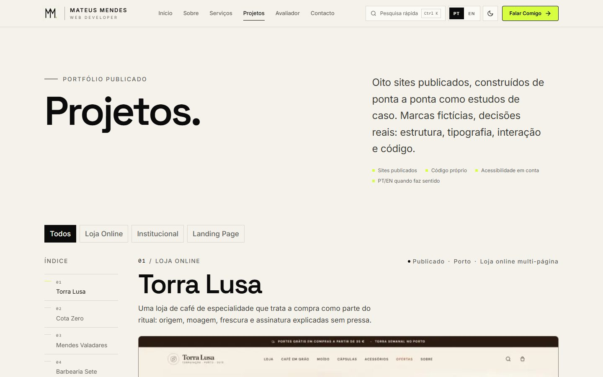
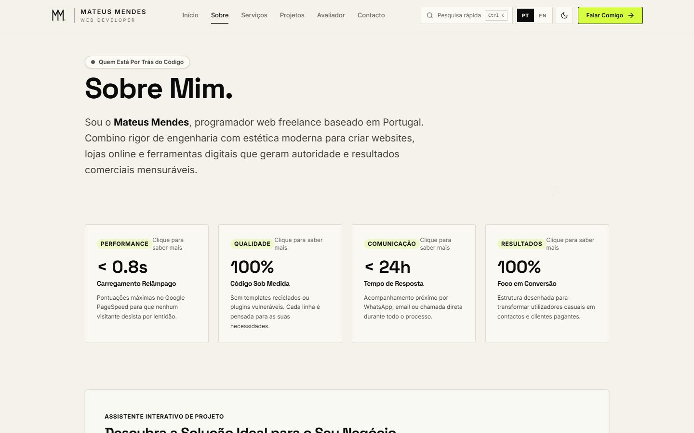
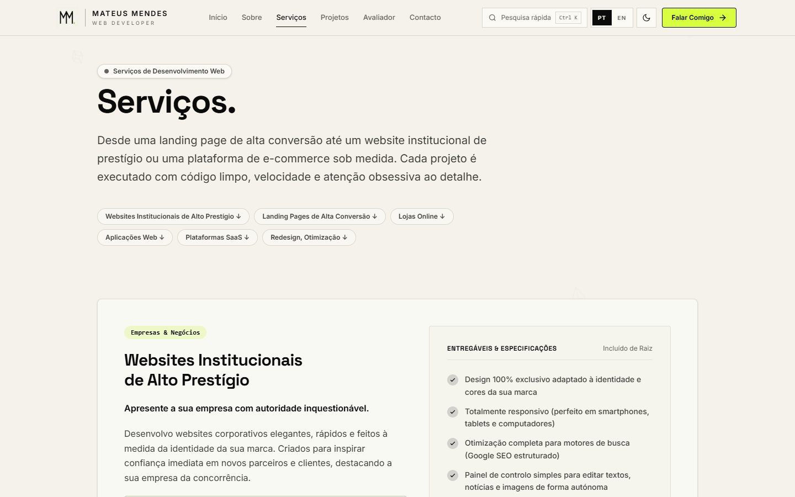

<div align="center">

# Portfólio Mateus Mendes

**Website de um programador web freelance: projetos publicados, contacto direto e uma ferramenta própria que avalia o site de qualquer empresa.**

[](https://nextjs.org)
[](https://react.dev)
[](https://www.typescriptlang.org)
[](https://tailwindcss.com)
[](#scripts)


</div>

---

> **Estado:** em desenvolvimento. O domínio previsto é `mateusmendes.pt`, ainda por publicar.

## Sobre o projeto

Site em português (com versão em inglês) que apresenta serviços, projetos e forma de trabalhar, e que tenta fazer uma coisa bem: **transformar visitantes em contactos**. Para isso tem duas ferramentas próprias que a maioria dos portfólios não tem:

- o **Avaliador de Sites**, que analisa o site de um visitante e devolve um relatório claro;
- a **marcação de chamadas** integrada na página de contacto, sem sair do site.

Tudo o que o site afirma é verificável: os resultados mostrados nos projetos são **medidos** pelo próprio Avaliador e pelo Google PageSpeed, com a data da medição. Não há estatísticas nem testemunhos inventados.

## Avaliador de Sites


Em `/avaliador`, o visitante cola o endereço de um site e, em cerca de 30 segundos, recebe um relatório em linguagem de dono de negócio.

- **7 categorias com peso na nota (0–100):** segurança, SEO técnico, mobile, desempenho (Google PageSpeed), acessibilidade, conteúdo/conversão e peso da página.
- **Cada ponto vem de uma verificação real**, com o que é, porque importa e como corrigir. A categoria sem dados (por exemplo sem PageSpeed) aparece como "Indisponível" e fica fora da média.
- **Relatório em PDF**: descarrega-se ou recebe-se por email, a partir da análise em cache.
- **Comparação** lado a lado com o site de um concorrente.
- **Simulador** de quanto vale converter melhor (visitas × conversão × valor, com os números do visitante).
- **Segurança:** proteção contra SSRF (DNS resolvido e IPs privados bloqueados, redirecionamentos revalidados), timeout, limite de tamanho, CSRF por `Origin`, honeypot e limites de pedidos. Não guarda relatórios nem dados pessoais.

A metodologia, os pesos, o catálogo de verificações e as limitações estão em [`docs/avaliador-metodologia.md`](docs/avaliador-metodologia.md).

## Contacto e marcação de chamadas


- **Dois separadores:** "Enviar mensagem" (formulário em fases) e "Marcar chamada".
- **Marcação rápida** (15 ou 30 minutos): grelha do mês onde só os dias com horários livres são clicáveis, hora numa caixa de combinação (escreve-se `14:30` ou escolhe-se da lista) e nome + email. Os horários vêm da API pública do [Cal.com](https://cal.com) e a marcação é criada por uma rota do próprio site (`/api/booking`).
- **Calendário completo** do Cal.com embebido, com as cores do site em claro e escuro, como alternativa.
- O formulário tem honeypot, limite de pedidos por IP, validação partilhada cliente/servidor (Zod) e envio via Resend com `Reply-To` para o visitante.

## Newsletter e checklist

Quem subscreve recebe por email o **Checklist de Conversão** (PDF de 12 pontos, em `public/lead-magnet/`), gerado por [`scripts/generate-lead-magnet.ts`](scripts/generate-lead-magnet.ts). Os limiares usados vêm da Google (Core Web Vitals), da WCAG e das verificações do Avaliador.

## Projetos com medições reais

Os oito projetos publicados são **demonstrações com marcas fictícias**, e o site di-lo. Cada página de projeto mostra a nota do Avaliador e o Lighthouse mobile medidos em 27/10/2026:

| Projeto | Nota do Avaliador | Lighthouse (mobile) | LCP |
| --- | :---: | :---: | :---: |
| Aqualis | 98 | 96 | 2,1 s |
| Cota Zero | 95 | 99 | 2,0 s |
| Torra Lusa | 95 | 76 | 4,1 s |
| Mendes Valadares | 93 | 100 | 1,7 s |
| Dentilusa | 93 | 82 | 3,5 s |
| Barbearia Sete Colinas | 92 | 100 | 1,7 s |
| Forja | 91 | 80 | 3,8 s |
| Lumina | 88 | 90 | 3,1 s |

Os números vivem em `src/content/site-metrics.ts`, **gerado** por [`scripts/measure-sites.ts`](scripts/measure-sites.ts) (nunca escritos à mão).

## Outras funcionalidades

- **PT / EN** com alternância sem recarregar a página.
- **Tema claro/escuro**, a seguir a preferência do sistema.
- **Animações** com `framer-motion`, desativadas para quem usa *reduced motion*.
- **SEO técnico:** canonical, `sitemap.xml`, `robots.txt`, Open Graph e Twitter Cards por página.
- **Acessibilidade:** skip-link, foco visível, separadores e caixa de combinação com ARIA.
- **Aviso de cookies** e página de política de privacidade.

## Screenshots

| | |
| :---: | :---: |
|  |  |
|  |  |

## Stack

| Camada | Tecnologia |
| --- | --- |
| Framework | Next.js 16 (App Router, Turbopack) |
| Linguagem | TypeScript (modo estrito) |
| UI | React 19 + Tailwind CSS v4 |
| Animações | framer-motion |
| Validação | Zod 4 (partilhado entre cliente e servidor) |
| Análise de HTML | node-html-parser |
| PDF | pdf-lib |
| Email | Resend |
| Marcações | Cal.com (`@calcom/embed-react` + API pública) |
| Desempenho | Google PageSpeed Insights API |
| Testes | Vitest |
| Tema | next-themes |

## Correr localmente

Requisitos: [Node.js](https://nodejs.org) ≥ 20.9 e npm.

```bash
git clone https://github.com/MateusMendes17/portofolio-mateus.git
cd portofolio-mateus
npm install
cp .env.local.example .env.local
npm run dev
```

Abre <http://localhost:3000>. O site arranca sem variáveis; cada funcionalidade que precisa de um serviço externo só fica ativa quando a variável correspondente está definida.

### Variáveis de ambiente

As variáveis `NEXT_PUBLIC_*` são lidas no arranque e na build, por isso reinicia o servidor depois de as alterar.

| Variável | Para quê |
| --- | --- |
| `RESEND_API_KEY` | Envio de emails (contacto, newsletter, relatório PDF). Sem ela, o formulário responde `500` em produção, de propósito, para nunca fingir sucesso. |
| `RESEND_FROM` | Remetente. Por omissão `onboarding@resend.dev`, que só entrega ao email da conta Resend. Em produção, usa um domínio verificado. |
| `CONTACT_EMAIL` | Quem recebe os pedidos de contacto e os avisos de novos contactos. |
| `PAGESPEED_API_KEY` | Chave da API do Google PageSpeed (`AIza…`). Sem ela, o desempenho aparece "Indisponível" no Avaliador. |
| `NEXT_PUBLIC_CAL_URL` | Ligação do evento de 15 min no Cal.com. Sem ela, não aparece o separador "Marcar chamada". |
| `NEXT_PUBLIC_CAL_URL_30` | Opcional: evento de 30 min (mostra o seletor 15/30 min). |
| `NEXT_PUBLIC_SITE_URL` | URL base do site (sitemap, metadados, links nos emails). |
| `NEWSLETTER_FROM_EMAIL` | Opcional: remetente da newsletter, num domínio verificado. |
| `NEWSLETTER_SECRET` | Opcional: segredo que assina as ligações de cancelamento (por omissão usa a `RESEND_API_KEY`). |
| `RESEND_AUDIENCE_ID` | Opcional: audiência do Resend onde guardar os subscritores. |
| `AUDIT_DAILY_LIMIT` | Opcional: limite diário de análises do Avaliador (por omissão 100). |

Nunca faças commit do `.env.local`: já está no `.gitignore`.

## Scripts

| Comando | O que faz |
| --- | --- |
| `npm run dev` | Servidor de desenvolvimento |
| `npm run build` / `npm run start` | Build de produção / servir a build |
| `npm run lint` | ESLint |
| `npm run typecheck` | `tsc --noEmit` |
| `npm test` | Testes (Vitest) |
| `npx tsx --env-file=.env.local scripts/measure-sites.ts` | Mede os projetos (Avaliador + PageSpeed) e atualiza `src/content/site-metrics.ts` |
| `npx tsx scripts/generate-lead-magnet.ts` | Regera o PDF do checklist |

## Estrutura

```
src/
├── app/                      # Rotas (App Router) + API
│   ├── api/audit/            # Análise do Avaliador (stream) e /report (PDF)
│   ├── api/booking/          # Horários livres e criação de marcações (Cal.com)
│   ├── api/contact/          # Formulário de contacto
│   ├── api/newsletter/       # Subscrição + checklist em anexo
│   └── avaliador/, contacto/, projetos/, sobre/, servicos/, privacidade/
├── components/
│   ├── audit/                # Comparação, relatório PDF, simulador, medições
│   ├── contact/              # Marcação: grelha do mês, hora, calendário Cal.com
│   ├── forms/ layout/ projects/ ui/ views/ interactive/
├── content/                  # Textos (pt/en), projetos e medições
├── context/                  # LanguageContext
└── lib/
    ├── audit/                # Verificações, pontuação, SSRF-safe fetch, PDF, cache
    └── …                     # Constantes, validação, rate limit, email, SEO
scripts/                      # measure-sites.ts, generate-lead-magnet.ts
docs/                         # Metodologia do Avaliador e auditorias
```

## Endpoints

| Método e rota | O que faz |
| --- | --- |
| `POST /api/audit` | Analisa um site e devolve o progresso e o resultado em stream (NDJSON) |
| `POST /api/audit/report` | Gera o PDF da análise (download ou email, com consentimento) |
| `GET /api/booking/slots` | Horários livres dos próximos 21 dias |
| `POST /api/booking` | Cria uma marcação no Cal.com |
| `POST /api/contact` | Envia um pedido de contacto |
| `POST /api/newsletter` | Subscreve e envia o checklist (com ligação de cancelamento assinada) |
| `POST /api/newsletter/unsubscribe` | Cancela a subscrição (ligação assinada ou cabeçalho `List-Unsubscribe` de um clique) |

Todas as rotas que escrevem validam o `Origin`, usam limites de pedidos por IP e **não registam dados pessoais nos logs**.

## Deploy

Pensado para a **Vercel**: importa o repositório, define as variáveis de ambiente acima (incluindo as `NEXT_PUBLIC_CAL_URL*`) e publica. Qualquer host Node ≥ 20.9 também serve (`npm run build && npm run start`).

> A cache e os limites de pedidos do Avaliador e das marcações vivem em memória, por instância. Chegam para começar; com muito tráfego, passa-os para um armazenamento partilhado (por exemplo Upstash).

## Autor

**Mateus Mendes** — programador web freelance em Portugal

- LinkedIn: [mateus-lucas-mendes](https://www.linkedin.com/in/mateus-lucas-mendes-0538b7333/)
- GitHub: [@MateusMendes17](https://github.com/MateusMendes17)
- Email: mateusmm.dev@gmail.com · WhatsApp: [+351 917 810 763](https://wa.me/351917810763)

---

<details>
<summary><b>English summary</b></summary>

Portfolio and business site for a freelance web developer in Portugal, built with **Next.js 16**, **React 19**, **TypeScript** and **Tailwind CSS v4**, with a PT/EN toggle and light/dark themes.

It includes a **Website Evaluator** (`/avaliador`) that analyses a public home page across 7 weighted categories (security, SEO, mobile, performance via Google PageSpeed, accessibility, content, page weight), exports a **PDF report**, compares two sites side by side and includes a conversion simulator; and a **call booking** flow on the contact page (month grid + time combobox, powered by the Cal.com API, with the full Cal.com calendar as a fallback). The project pages show real, dated Lighthouse and Evaluator measurements instead of invented claims.

Run locally with `npm install && cp .env.local.example .env.local && npm run dev` (Node ≥ 20.9). Each feature that needs an external service is enabled only when its environment variable is set (see the table above).

</details>
